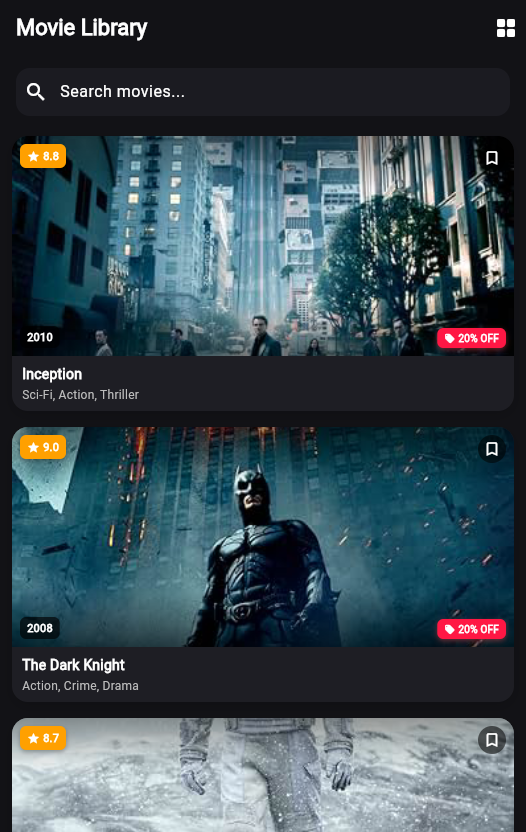
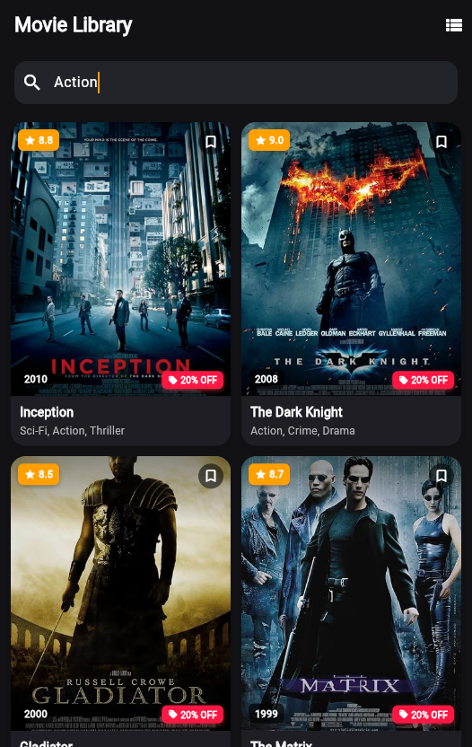

# Movie Library App (Flutter)

A Flutter movie library application built with Material 3 showcasing movie collections with dual layouts (ListView and GridView), real-time search filtering without controllers, Stack and Container overlays, and synchronized card state.

---

## 📸 Screenshots

| List View | Grid View (Search Applied: "Action") |
|:---:|:---:|
|  |  |

---

## 🚀 Features

- **Data Model (`Movie`)**:
  - Strongly-typed `Movie` model with `title`, `genre`, `year`, `rating`, and `image`.
  - Const constructor with named required parameters.
  - Curated list of 10 iconic movies with local poster assets.

- **Local Images (`assets/posters/`)**:
  - 10 real movie posters loaded locally via `Image.asset()`.
  - Properly declared and registered in `pubspec.yaml`.

- **Movie Card Widget (`MovieCard`)**:
  - Implemented as a clean `StatelessWidget`.
  - Outer `Container` with rounded corners (`borderRadius: 16`), custom shadow (`boxShadow`), theme background color, and `clipBehavior: Clip.antiAlias`.
  - Top poster image with `Stack` and `Positioned` widgets:
    - **Rating badge** (TOP-LEFT) with star icon and rounded badge container.
    - **Bookmark icon** (TOP-RIGHT).
    - **Release year** (BOTTOM-LEFT).
    - **Bonus Discount badge** (BOTTOM-RIGHT).
  - Below poster: Bold movie title and grey genre text with ellipsis overflow handling.

- **Dual Layouts with Builders**:
  - `ListView.builder` for single-card full-width rows.
  - `GridView.builder` with `SliverGridDelegateWithFixedCrossAxisCount` (2 columns, `childAspectRatio: 0.68`).
  - View toggle button in `AppBar` switching smoothly between list and grid views using `setState()`.

- **Search (No `TextEditingController`)**:
  - Zero `TextEditingController` usage.
  - Uses `onChanged` property on `TextField` to update search query in state.
  - Case-insensitive filtering on both movie **TITLE** and **GENRE** using `.where()` and `.toList()`.
  - Centered `"No movies found"` message when no matches exist.

- **⭐ BONUS: One Tap, All Cards Change**:
  - State Lifting pattern: Shared `discount` value is stored in `_HomePageState`.
  - Tapping the discount badge on **ANY** card triggers a `VoidCallback` to `_HomePageState.setState()`.
  - All cards update simultaneously (e.g. 20% -> 19% -> 18% ...).
  - `MovieCard` remains strictly a `StatelessWidget` with no third-party state management libraries.

---

## 📁 Project Structure

```
lib/
  main.dart         -> MaterialApp + dark cinema theme
  home_page.dart    -> HomePage (Stateful, search + view toggle + lifted state)
  movie_card.dart   -> MovieCard (Stateless, Container + Stack layout)
  movie.dart        -> Movie class + dataset
assets/posters/     -> local movie poster images
screenshots/        -> list_view.png & grid_view_search.png
```

---

## 🛠️ Getting Started

1. Clone the repository:
   ```bash
   git clone <REPO_URL>
   cd movie_library_app
   ```
2. Fetch dependencies:
   ```bash
   flutter pub get
   ```
3. Run the app:
   ```bash
   flutter run
   ```
4. Run the automated test suite:
   ```bash
   flutter test
   ```
